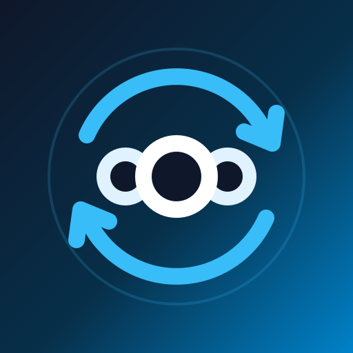

<p align="center">
  
</p>

<h1 align="center">Aether</h1>

<p align="center">
  A native Android client for <a href="https://nextcloud.com">Nextcloud</a> that works like Dropbox:<br>
  your files show up in Android's own file manager, with no second file browser to learn.
</p>

<p align="center">
  <a href="https://github.com/DougieWougie/aether/actions/workflows/ci.yml"></a>
  <a href="LICENSE"></a>
  
</p>

> **Status:** early development (v0.1.0). It is not yet on Google Play.

## Why Aether

Most cloud clients ship their own file manager next to the one Android already has. Aether does the opposite: it
plugs into the platform and keeps its own UI small.

- **Files live in the system file manager.** Aether is a Storage Access Framework `DocumentsProvider`, so your
  Nextcloud shows up in the Files app and in every app's file picker, and any app can open or save to it.
- **Sharing is native.** Send files to Nextcloud from the Android share sheet.
- **Sign-in is the browser's job.** Login uses Nextcloud Login Flow v2 in a Custom Tab, so 2FA, SSO and password
  managers just work. There is no embedded `WebView`.
- **Credentials live in `AccountManager`**, as an app password you can revoke from the Nextcloud web UI.

## Features

- Browse, open, create, rename, move and delete files through the system file manager.
- Safe write-back: edits made by other apps are staged and uploaded with `If-Match`, so a change made on the server
  in the meantime is never overwritten. On a conflict your version is saved as a conflict copy.
- Offline pinning of files and folders, kept up to date in the background by comparing ETags.
- Automatic camera backup of new photos and videos, with network and charging constraints.
- Large uploads use Nextcloud's chunked upload v2.
- Clear errors, such as a file that is locked on the server because it is open in a web editor.
- A small companion app in Material 3 Expressive with your profile picture, a storage ring, transfers, offline pins
  and camera backup settings.

## How it works

| Area | Approach |
| :-- | :-- |
| File access | `DocumentsProvider` backed by a Room metadata cache and an ETag-validated LRU disk cache |
| Auth | Login Flow v2 over Custom Tabs, credentials in `AccountManager` |
| Network | `OkHttp` and Android's `XmlPullParser` for WebDAV, with no WebDAV library |
| Background work | `WorkManager` for uploads, pinned sync and camera backup (`ContentUriTriggers`) |
| UI | Jetpack Compose, Material 3 Expressive, Dynamic Color |

Every significant decision is written up in [`docs/adr`](docs/adr/README.md).

## Requirements

- Android 10 (API 29) or newer
- A Nextcloud server you can reach over HTTPS

## Building

You need JDK 17 and the Android SDK (compile SDK 37). Create a `local.properties` pointing at the SDK if Android
Studio hasn't already (`sdk.dir=/path/to/Android/Sdk`).

```bash
./gradlew assembleDebug        # build the debug APK
./gradlew testDebugUnitTest    # JVM unit tests
./gradlew lintDebug            # Android lint
```

CI runs lint and the unit tests on every push and pull request.

## Contributing

Read [`CLAUDE.md`](CLAUDE.md) and the [ADRs](docs/adr/README.md) before changing the architecture. In short:
lean on Android platform components, keep WebDAV on `OkHttp` and `XmlPullParser`, and record significant changes
to auth, sync, the provider or the UI design in an ADR.

## License

Aether is free software, licensed under the [GNU General Public License v3.0 or later](LICENSE).
